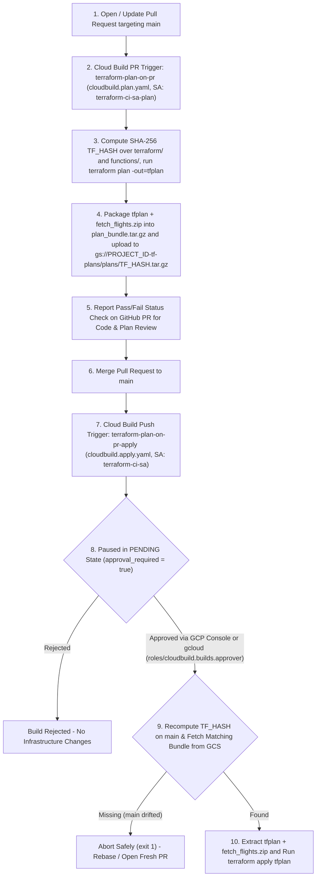

# Serverless Flight Tracking Pipeline (ELT Architecture)

This document provides a comprehensive technical overview of the serverless Extract-Load-Transform (ELT) flight price tracking pipeline on Google Cloud Platform (GCP), detailing its end-to-end architecture, step-by-step lifecycle, code specifications, price-low alerting, GitOps CI/CD workflow (Cloud Build + Terraform), and least-privilege IAM model.

---

## 1. High-Level Architecture

The pipeline follows a modern **ELT (Extract, Load, Transform)** pattern on Google Cloud Platform:
1. **Extract & Load:** Scrape raw, untransformed flight data (outbound round-trip options and return leg options) from Google Flights and immediately land it as JSON Lines (`.jsonl`) into Google Cloud Storage (GCS).
2. **Transform (Medallion Architecture):** Ingest raw files into BigQuery via a BigLake External Table, where Dataform handles SQL transformations (return-leg enrichment, `trip_type` & `search_name` filtering, deduplication, and star-schema dimensional modeling).
3. **Evaluate & Alert:** Dataform computes price-low metrics (`mart_price_alerts`) against historical lows and configurable target price thresholds; Cloud Workflows emits a structured alert log (`FLIGHT_PRICE_LOW_ALERT`) that triggers a Cloud Monitoring log-based email notification..
```
[Cloud Scheduler]
 (Cron triggers per search target in terraform.tfvars)
       │
       ▼ (HTTP POST with search_name, trip_type, target_price, dates, route)
[Cloud Workflows (flights-data-pipeline)]
 (Orchestrator: manages execution, Dataform polling & alert logging)
       │
       ├──► 1. HTTP POST (OIDC Auth) ──► [Cloud Function (fetch-flights)]
       │                                  (Python 3.10 / fast-flights scraper)
       │                                         │
       │                                         ▼ (Raw JSONL upload)
       │                                 [Google Cloud Storage (GCS)]
       │                                  gs://<raw-bucket>/raw/source=google_flights/dt=YYYY-MM-DD/{scrape_id}.jsonl
       │                                         │
       │                                         ▼ (BigLake Hive-Partitioned External Table)
       │                                 [BigQuery Raw Layer: raw_flight_data.ext_google_flights]
       │
       ├──► 2. Compile & Invoke ───────► [Dataform Execution API]
       │    (waits for SUCCEEDED)         ├── Silver (`flight_staging.stg_google_flights`):
       │                                  │    Unnests metadata, enriches round-trip rows with return leg
       │                                  │    departure time & duration, filters by `search_name` & `trip_type`
       │                                  ├── Gold Dimension (`flight_marts.dim_flight_itinerary`):
       │                                  │    Incremental unique flight itineraries (outbound & return times/durations)
       │                                  ├── Gold Fact (`flight_marts.fct_flight_prices`):
       │                                  │    Incremental time-series price observations partitioned by `scraped_at_date`
       │                                  └── Gold Alert (`flight_marts.mart_price_alerts`):
       │                                       Evaluates today's lowest price vs. historical low & `target_price`
       │
       └──► 3. Query `mart_price_alerts` & Emit `FLIGHT_PRICE_LOW_ALERT` Log
                                                 │
                                                 ▼
                                         [Cloud Monitoring Log-Based Alert Policy]
                                          └── Sends formatted Markdown Email Notification
```

---

## 2. Step-by-Step Pipeline Flow

### Step 1: Trigger & Parameterization (Cloud Scheduler)
- **Module:** `terraform/modules/scheduler`
- **Mechanism:** Cloud Scheduler runs on user-defined cron schedules per search entry in `terraform.tfvars` (e.g., `0 8 */2 * *`).
- **Key Feature:** Cloud Scheduler acts as the **parameter source**. Each scheduled job injects its map key as `search_name` along with route, dates, `trip_type`, and `target_price` into the HTTP POST body sent to the Workflows Execution API.
- **Payload sent to Workflows:**
  ```json
  {
    "argument": "{\"search_name\": \"canada\", \"origin\": \"BRU\", \"destination\": \"YUL\", \"start_date\": \"2027-07-01\", \"trip_length\": 24, \"flexibility_window\": 2, \"trip_type\": \"round-trip\", \"target_price\": 600, \"currency\": \"EUR\", \"seat\": \"economy\", \"adults\": 1, \"max_stops\": 0}"
  }
  ```

### Step 2: Dynamic Orchestration (Cloud Workflows)
- **Module:** `terraform/modules/workflows`
- **Definition:** `terraform/modules/workflows/workflow.yaml`
- **Mechanism:**
  1. Receives runtime parameters (`args`) from Cloud Scheduler (or manual execution).
  2. Invokes the `fetch-flights` Cloud Function via OIDC authentication.
  3. Compiles the Dataform repository, passing `search_name`, `trip_type`, and `target_price` into `codeCompilationConfig.vars`.
  4. Triggers a Dataform workflow invocation and polls its status every 5 seconds until `state == "SUCCEEDED"`.
  5. Queries `flight_marts.mart_price_alerts` where `should_alert = TRUE`.
  6. If a low price is detected, writes a structured `FLIGHT_PRICE_LOW_ALERT` entry to Cloud Logging (`severity: "WARNING"`), triggering the Cloud Monitoring email alert policy.

### Step 3: Raw Extraction (Cloud Function: `fetch-flights`)
- **Source Directory:** `functions/fetch_flights/`
- **Entrypoint:** `fetch_flights(request)` in `main.py`
- **Scraper Engine:** `fast_flights_scraper.py`
- **Process:**
  1. Parses incoming query parameters (`search_name`, `origin`, `destination`, `start_date`, `trip_length`, `flexibility_window`, etc.).
  2. Generates a symmetric Cartesian product of `(outbound_date, return_date)` pairs based on `flexibility_window`.
  3. For each date pair, scrapes:
     - **Round-trip options (`trip="round-trip"`):** Captures outbound flight leg details and the combined round-trip price.
     - **Return leg options (`trip="one-way"`, `destination -> origin` on `return_date`):** Captures return flight departure times and durations so Dataform can enrich round-trip itineraries.
  4. Preserves **100% of the raw data** returned by the scraper and attaches `_query_meta` (`search_name`, `outbound_date`, `return_date`, `origin`, `destination`, `trip`, `currency`, `seat`).

### Step 4: Storage Landing Zone (Google Cloud Storage)
- **Module:** `terraform/modules/storage`
- **Storage Pattern:** Hive-partitioned directory layout:
  ```text
  gs://<RAW_DATA_BUCKET>/raw/source=google_flights/dt=YYYY-MM-DD/<scrape_id>.jsonl
  ```
- **Format:** Newline-delimited JSON (`application/x-ndjson`).
- **Features:**
  - `uniform_bucket_level_access = true` for bucket-level IAM.
  - Object versioning enabled and 90-day lifecycle deletion rule.
  - Append-only access (`roles/storage.objectCreator`) for the Cloud Function service account.

### Step 5: Transformations & Low-Price Detection (BigQuery & Dataform)
- **BigLake External Table (`raw_flight_data.ext_google_flights`):** Maps directly over `gs://<RAW_DATA_BUCKET>/raw/source=google_flights/*` using automatic Hive partitioning (`dt` DATE column).
- **Dataform Medallion Architecture (`definitions/`):**
  1. **Sources (`definitions/sources/declarations.sqlx`):** Declares `ext_google_flights` in `raw_flight_data`.
  2. **Silver Staging View (`definitions/staging/stg_google_flights.sqlx` in `flight_staging`):**
     - Parses raw records and extracts `_query_meta` fields (`search_name`, `trip_type`, dates, times, durations).
     - Joins `one-way` return leg records (`destination -> origin`) onto `round-trip` records for the same `(scraped_at_date, search_name, outbound_date, return_date)` (matching same airline first, with cheapest return flight as fallback) to populate `return_departure_time` and `return_duration_mins`.
     - Filters output by `vars.search_name` and `vars.trip_type` (when `trip_type` is empty `""`, both `round-trip` and `one-way` rows are kept; when set to `"round-trip"` or `"one-way"`, only matching rows pass through).
     - Generates a deterministic MD5 `flight_itinerary_key`.
  3. **Gold Dimension Table (`definitions/marts/dim_flight_itinerary.sqlx` in `flight_marts`):**
     - Incremental table storing unique flight itineraries (`search_name`, `origin_airport`, `destination_airport`, `outbound_date`, `return_date`, `airlines`, `trip_type`, `outbound_departure_time`, `outbound_duration_mins`, `return_departure_time`, `return_duration_mins`), clustered by `["search_name", "origin_airport", "destination_airport", "airlines"]`.
  4. **Gold Fact Table (`definitions/marts/fct_flight_prices.sqlx` in `flight_marts`):**
     - Incremental time-series price observations partitioned by `scraped_at_date` and clustered by `["search_name", "flight_itinerary_key", "price"]`. Computes `days_to_departure` and `trip_duration_days`, deduplicated via `observation_id`.
  5. **Gold Alert Table (`definitions/marts/mart_price_alerts.sqlx` in `flight_marts`):**
     - Identifies the cheapest flight in today's scrape (`scraped_at_date = CURRENT_DATE()`) per `search_name`.
     - Compares `current_price` against prior days' historical minimum (`prev_min_price` where `scraped_at_date < CURRENT_DATE()`) and `vars.target_price`.
     - Sets `should_alert = TRUE` whenever `current_price < prev_min_price` (new all-time historical low) or `current_price <= target_price` (at or below target threshold).

### Step 6: Notification Delivery (Cloud Monitoring)
- **Module:** `terraform/modules/monitoring`
- **Policies:**
  1. **Workflow Failure Alert Policy:** Alerts immediately if any execution of `flights-data-pipeline` finishes with a status other than `SUCCEEDED`.
  2. **Flight Low Price Alert Policy (`google_monitoring_alert_policy.flight_price_low_policy`):** Matches `jsonPayload.event_type = "FLIGHT_PRICE_LOW_ALERT"` logs from the workflow, extracts all flight attributes (`search_name`, `alert_reason`, `origin`, `destination`, `current_price`, `previous_min_price`, `target_price`, `outbound_date`, `departure_time`, `outbound_duration_mins`, `return_date`, `return_departure_time`, `return_duration_mins`, `airlines`), and emails a formatted Markdown summary to `alert_email_address`.

---

## 3. Code & Technical Specifications

### `functions/fetch_flights/fast_flights_scraper.py`

#### 1. Anti-Bot & Consent Handling
```python
class ConsentAwareFetchIntegration(FetchIntegration):
    def fetch_html(self, q) -> str:
        return Client(impersonate="chrome_145").get(
            "https://www.google.com/travel/flights/search",
            params=q.params(),
            headers={"cookie": "SOCS=CAESEwgDEgk2ODEwNTc2NjIaAmVuIAEaBgiA_LyaBg"},
        ).text
```
- **`primp` Client:** Mimics browser TLS/JA3 fingerprints using `impersonate="chrome_145"`.
- **`SOCS` Cookie:** Static Base64 protobuf state that dismisses Google's EU/GDPR consent interstitial.

#### 2. Symmetric Date Pair Generation
```python
def generate_flexible_date_pairs(
    start_date: str, trip_length: int, flexibility_window: int = 0
) -> list[tuple[str, str]]:
```
- Generates `(2 * flexibility_window + 1)^2` combinations of `(outbound_date, return_date)` around `start_date` and `trip_length`.

---

## 4. Configuration Guide

### Adding or Modifying Search Targets
Edit `flight_searches` in `terraform/terraform.tfvars`:

```hcl
flight_searches = {
  canada = {
    schedule           = "0 8 */2 * *"  # Every 2 days at 08:00 Europe/Brussels
    origin             = "BRU"
    destination        = "YUL"
    start_date         = "2027-07-01"
    trip_length        = 24
    flexibility_window = 2
    trip_type          = "round-trip"   # "round-trip", "one-way", or "" (both)
    target_price       = 600            # Optional target price threshold for email alerts
    currency           = "EUR"
    seat               = "economy"
  }
}
```
Running `terraform apply` automatically provisions/updates the Cloud Scheduler job for each entry in `flight_searches`.

---

## 5. Manual Execution & Testing

### Triggering via Google Cloud CLI
```bash
gcloud workflows execute flights-data-pipeline \
  --location=europe-west1 \
  --data='{
    "search_name": "canada",
    "origin": "BRU",
    "destination": "YUL",
    "start_date": "2027-07-01",
    "trip_length": 24,
    "flexibility_window": 1,
    "trip_type": "round-trip",
    "target_price": 600,
    "currency": "EUR"
  }'
```

### Local Testing of the Scraper
```bash
export RAW_DATA_BUCKET="serverless-data-pipeline-111-raw-data"
python3 functions/fetch_flights/fast_flights_scraper.py
```

---

## 6. CI/CD Pipeline & Pull Request Workflow (Cloud Build + Terraform)

Infrastructure changes are managed through a two-stage, GitOps **Plan-on-PR / Approval-Gated-Apply-on-Main** pipeline defined in `terraform/modules/cicd/main.tf`, `cloudbuild.plan.yaml`, and `cloudbuild.apply.yaml`.

### 6.1 End-to-End CI/CD Flow



### 6.2 Two-Trigger Architecture: Why PRs vs. Merges Differ on Approval

The CI/CD module (`terraform/modules/cicd/main.tf`) intentionally separates **untrusted PR validation** from **privileged production mutation** across two distinct Cloud Build triggers and service accounts:

| Attribute | PR Plan Trigger (`terraform_plan_trigger`) | Main Apply Trigger (`terraform_apply_trigger`) |
| :--- | :--- | :--- |
| **Trigger Name** | `terraform-plan-on-pr` (`var.cloud_build_trigger_name`) | `terraform-plan-on-pr-apply` (`${var.cloud_build_trigger_name}-apply`) |
| **GitHub Event** | Pull request targeting `^main$` | Push / merge to `^main$` |
| **Build Config** | `cloudbuild.plan.yaml` | `cloudbuild.apply.yaml` |
| **Service Account** | `terraform-ci-sa-plan` (**Read-only** project viewer + state/plan bucket access) | `terraform-ci-sa` (**Admin** roles across managed GCP services) |
| **Cloud Build Approval** | **None** (`approval_config` omitted — runs automatically) | **Required** (`approval_required = true` — pauses in `PENDING` state) |
| **GitHub Visibility** | Reports pass/fail status check directly on the open GitHub PR | Post-merge build in GCP Cloud Build History (not a PR check) |

- **Why PR builds run without manual Cloud Build approval:** `terraform-plan-on-pr` executes strictly under the read-only `terraform-ci-sa-plan` identity (`roles/viewer`, `roles/iam.securityReviewer`, `roles/storage.objectViewer`, plus `roles/storage.objectUser` scoped only to `<project_id>-tfstate` for state locking and `<project_id>-tf-plans` for saving plan bundles). Because unmerged feature branches cannot mutate infrastructure or read secrets, running automatically gives developers immediate PR check feedback.
- **Why `main` builds require explicit Cloud Build approval:** `terraform-plan-on-pr-apply` runs under the privileged `terraform-ci-sa` account. Setting `approval_required = true` halts the build in `PENDING` status **before any container step starts** until an authorized principal in `var.terraform_apply_approvers` (granted `roles/cloudbuild.builds.approver`) explicitly approves the deployment.

### 6.3 Cryptographic Plan-to-Apply Integrity (`TF_HASH` & Artifact Bundling)

Rather than running an unreviewed `terraform apply -auto-approve` on `main`, the pipeline guarantees that **`terraform apply` executes the exact binary plan reviewed on the PR**:

1. **Deterministic Source Hashing (`TF_HASH`):**
   Both `cloudbuild.plan.yaml` and `cloudbuild.apply.yaml` compute an identical SHA-256 digest across all non-ephemeral files in `terraform/` and `functions/` (excluding `.terraform/`, `__pycache__/`, `.venv/`, `*.zip`, `*.tfstate*`, and `.DS_Store`, sorted deterministically with `LC_ALL=C`):
   - Any modification to `.tf` configs, `terraform.tfvars`, `.terraform.lock.hcl`, `terraform/modules/workflows/workflow.yaml`, or Python scraper code in `functions/fetch_flights/` produces a unique `TF_HASH`.
2. **Why `plan_bundle.tar.gz` Packages Both `tfplan` and `fetch_flights.zip`:**
   - During `terraform plan`, `data "archive_file" "function_zip"` (`terraform/modules/cloud_function/main.tf`) builds `terraform/modules/cloud_function/fetch_flights.zip` using `output_file_mode = "0666"` (ensuring deterministic archive checksums across environments) and embeds its file path and MD5 checksum inside `/workspace/tfplan`.
   - When `terraform apply /workspace/tfplan` runs later inside a fresh, ephemeral Cloud Build container, **Terraform does not re-evaluate `data "archive_file"` data sources when applying a saved binary plan**—it expects `terraform/modules/cloud_function/fetch_flights.zip` to already exist on disk matching the planned hash.
   - `cloudbuild.plan.yaml` therefore archives `/workspace/tfplan` together with all generated `terraform/**/*.zip` files into `gs://<project_id>-tf-plans/plans/<TF_HASH>.tar.gz`, and `cloudbuild.apply.yaml` extracts them back into `/workspace` prior to `terraform apply`.
3. **Drift Protection & Automatic Cleanup:**
   - If `main` advanced after the PR's plan ran (or if an unreviewed commit was pushed directly to `main`), `cloudbuild.apply.yaml` computes the new `TF_HASH`, finds no matching `gs://<project_id>-tf-plans/plans/<TF_HASH>.tar.gz` object in GCS, and **aborts safely (`exit 1`) before modifying any GCP resource**, instructing the operator to rebase or open a fresh PR to generate a reviewed plan.
   - Abandoned or superseded plan bundles in `<project_id>-tf-plans` are automatically deleted after **14 days** via a GCS bucket `lifecycle_rule`.

### 6.4 Step-by-Step Developer & Approver Guide

#### Step 1: Open or Update a Pull Request
1. Create a feature branch, commit your changes (`terraform/`, `functions/`, or `definitions/`), and open a Pull Request targeting `main`.
2. GitHub automatically triggers **`terraform-plan-on-pr`**.
3. In the GitHub PR **Checks** section, click **Details** next to the Cloud Build check (or open **GCP Console → Cloud Build → History**) to inspect the `terraform plan` output and verify the computed `TF_HASH` and planned resource diff. Pushing new commits to the PR branch automatically runs a fresh plan and uploads a new `<TF_HASH>.tar.gz` bundle.

#### Step 2: Review & Merge to `main`
1. Confirm the `terraform-plan-on-pr` status check is green and review the exact planned resource changes in the build log.
2. Merge the Pull Request into `main`.

#### Step 3: Locate & Approve the `PENDING` Apply Build
Merging to `main` immediately triggers **`terraform-plan-on-pr-apply`**, which pauses in **`PENDING`** status awaiting manual approval.

> **Important:** Because the Pull Request is already merged when the push-to-`main` trigger fires, **`PENDING` apply builds do not appear as status checks on the merged GitHub PR**. Approvers must approve the build in GCP Console or via `gcloud`.

- **Option A — GCP Console:**
  1. Navigate to **Cloud Build → History** in the Google Cloud Console (`https://console.cloud.google.com/cloud-build/builds?project=<PROJECT_ID>`).
  2. Locate the build at the top of the list with status **Pending approval** (`terraform-plan-on-pr-apply`).
  3. Click the build ID, click **Approve** (requires `roles/cloudbuild.builds.approver`), add an optional approval comment, and confirm. Cloud Build will verify `TF_HASH`, download `plan_bundle.tar.gz`, and execute `terraform apply`.

- **Option B — Google Cloud CLI (`gcloud`):**
  ```bash
  # 1. List Cloud Build runs currently waiting in PENDING state
  gcloud builds list \
    --project=<PROJECT_ID> \
    --filter="status=PENDING"

  # 2. Approve the PENDING apply build (requires roles/cloudbuild.builds.approver)
  gcloud alpha builds approve <BUILD_ID> \
    --project=<PROJECT_ID> \
    --comment="Approved reviewed PR plan for main deployment"
  ```
  *(To cancel an unwanted deployment instead, pass `--reject` to `gcloud alpha builds approve` or click **Reject** in the Console.)*

#### Note on Dataform SQL Changes (`definitions/`)
The managed Dataform repository (`flights-dataform-repo` in `terraform/modules/dataform/main.tf`) is linked directly to the GitHub repository's `main` branch (`default_branch = "main"`). When `.sqlx` transformations or assertions under `definitions/` are merged to `main`:
- **No Terraform resource diff is required:** Cloud Workflows compiles Dataform directly against the latest `main` branch commit on its next scheduled or manual run, picking up SQLX updates automatically.
- If a PR modifies *only* `definitions/` (with zero changes under `terraform/` or `functions/`), `terraform-plan-on-pr` produces a valid no-op plan bundle (`No changes. Your infrastructure matches the configuration.`), so approving or rejecting the post-merge `terraform-plan-on-pr-apply` build is safely a no-op for GCP infrastructure.

---

## 7. Least-Privilege IAM & Security Model

| Identity / Service Account | Granted Role | Scoped Resource | Purpose |
| :--- | :--- | :--- | :--- |
| `flights-scheduler-sa` | `roles/workflows.invoker` | Project | Allows Cloud Scheduler to trigger workflow executions. |
| `flights-pipeline-sa` | `roles/run.invoker`<br>`roles/cloudfunctions.invoker` | Cloud Function (`fetch-flights`) | Allows Cloud Workflows to invoke the scraper function via OIDC. |
| `flights-pipeline-sa` | `roles/dataform.editor` | Dataform Repo (`flights-dataform-repo`) | Allows Cloud Workflows to compile and invoke the Dataform repository. |
| `flights-pipeline-sa` | `roles/iam.serviceAccountUser` | `flights-dataform-sa` | Allows Cloud Workflows to pass `flights-dataform-sa` when invoking Dataform. |
| `flights-pipeline-sa` | `roles/bigquery.jobUser` | Project | Allows Cloud Workflows to submit BigQuery query jobs. |
| `flights-pipeline-sa` | `roles/bigquery.dataViewer` | BigQuery Dataset (`flight_marts`) | Allows Cloud Workflows to read `flight_marts.mart_price_alerts`. |
| `flights-pipeline-sa` | `roles/logging.logWriter` | Project | Allows Cloud Workflows to emit execution and `FLIGHT_PRICE_LOW_ALERT` logs. |
| `fetch-flights-sa` | `roles/storage.objectCreator` | GCS Raw Bucket | Append-only permission to upload `.jsonl` objects into the raw landing bucket. |
| `biglake-gcs-connection` SA | `roles/storage.objectViewer` | GCS Raw Bucket | Allows BigLake external table (`ext_google_flights`) to read raw `.jsonl` files. |
| `flights-dataform-sa` | `roles/bigquery.jobUser` | Project | Allows Dataform execution SA to run BigQuery SQL jobs. |
| `flights-dataform-sa` | `roles/bigquery.connectionUser` | BigLake Connection (`biglake-gcs-connection`) | Allows Dataform execution SA to query the BigLake external table. |
| `flights-dataform-sa` | `roles/bigquery.dataViewer` | BigQuery Dataset (`raw_flight_data`) | Read-only access to the raw external table dataset. |
| `flights-dataform-sa` | `roles/bigquery.dataEditor` | BigQuery Datasets (`flight_staging`, `flight_marts`, `flight_assertions`) | Scoped write access to manage Dataform views, incremental marts, and assertions. |
| Dataform Service Agent | `roles/secretmanager.secretAccessor` | Secret (`dataform-github-token`) | Allows Dataform service agent to read the GitHub PAT secret. |
| Dataform Service Agent | `roles/iam.serviceAccountTokenCreator`<br>`roles/iam.serviceAccountUser` | `flights-dataform-sa` | Allows Dataform service agent to impersonate `flights-dataform-sa`. |
| `terraform-ci-sa-plan` | `roles/viewer`<br>`roles/iam.securityReviewer`<br>`roles/storage.objectViewer`<br>`roles/logging.logWriter` | Project (+ `roles/storage.objectUser` on `tfstate` & `tf-plans` buckets) | Read-only service account used by unmerged PR Cloud Build `terraform plan` runs. |
| `terraform-ci-sa` | Service-specific Admin roles (`bigquery.admin`, `cloudfunctions.admin`, `run.admin`, `workflows.admin`, `cloudscheduler.admin`, `dataform.admin`, `monitoring.admin`, `storage.admin`, `secretmanager.admin`, `cloudbuild.builds.editor`, `iam.serviceAccountAdmin`, `iam.serviceAccountUser`, `iam.securityAdmin`, `serviceusage.serviceUsageAdmin`, `logging.logWriter`) | Project | Used strictly by the manual-approval-gated `terraform apply` trigger on `main`. |
| `var.terraform_apply_approvers` | `roles/cloudbuild.builds.approver` | Project | Human users or groups authorized to approve or reject `PENDING` `terraform apply` builds on `main`. |
